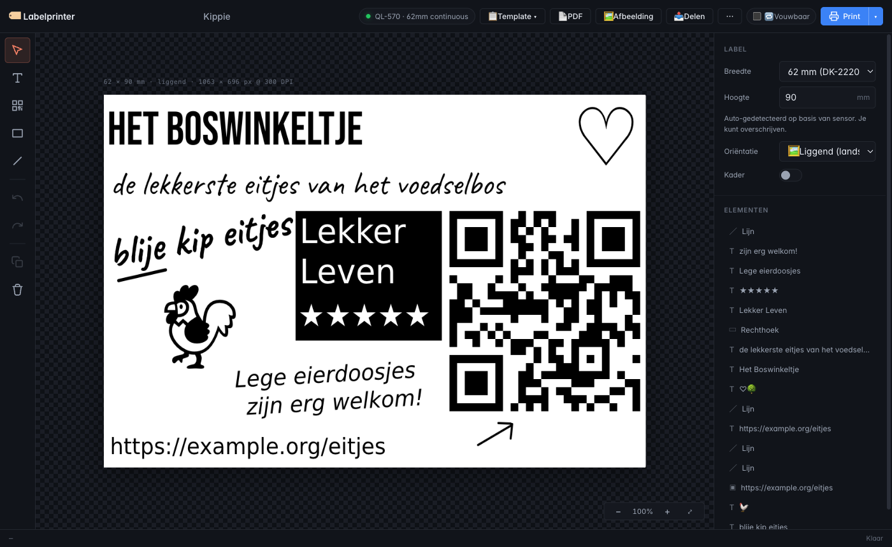
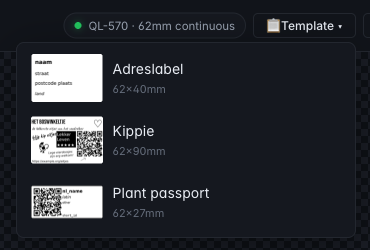
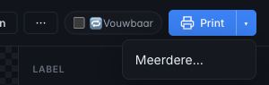

# Labelprinter

**Your label printer deserves better than a dusty desktop app.**

Design labels in the browser, print them from anywhere on your network, and let
your other software print them too. Labelprinter turns a **Brother QL-570** (and
compatible `brother_ql` models) into a small label service with a friendly
designer on top. Self-hosted, no account, no cloud.



## What you can do with it

- **Design it like a drawing.** Text, QR codes, rectangles and lines on a canvas,
  with bundled fonts, undo, multi-select and copy-paste across labels.
- **See what you'll get.** The preview runs at the printer's own 300 DPI.
- **Print once, or a whole batch.** Pick *Meerdere…* from the Print button for up
  to 99 copies.
- **Keep the printer off until you need it.** Labels wait in a queue and come out
  as soon as you switch it on.
- **Fold a label around a stem.** Fold mode prints your design twice on one strip,
  so a tag reads from both sides.
- **Reuse your favourites.** Templates with `{{placeholders}}`, picked by thumbnail.
- **Share a label as a link.** One click copies a URL with the whole design inside.
- **Print what you already have.** Drop in a PDF, such as a shipping label, or an
  image.
- **Automate everything.** A REST API for Rails, Home Assistant, shell scripts, or
  whatever else needs a label.

<table>
  <tr>
    <td></td>
    <td></td>
  </tr>
  <tr>
    <td>Choose a template by what it looks like</td>
    <td>Print one, or several</td>
  </tr>
</table>

The interface is in Dutch for now.

## Features

- **Client-side canvas designer** — position text, QR codes, rectangles, and lines
- **Live label preview** at actual 300 DPI, pixel-exact to what the printer produces
- **Inline editing** — double-click text on canvas, type, Tab through placeholders
- **Keyboard shortcuts** — V / T / Q / R / L for tools, Cmd-B / Cmd-I for style, Shift to constrain lines to 45° angles
- **Named server-side templates** with `{{placeholder}}` variables
- **Deep-link URLs** — `?template=<name>&var1=...&var2=...` opens a pre-filled design
- **PDF upload** — drag-and-drop arbitrary PDFs (shipping labels, anything), preview, print
- **Sensor-based label detection** — the service reads the loaded DK label from the printer and auto-scales
- **Template thumbnails** — see every template in the picker before you load it
- **Multiple copies** — print a label up to 99 times from the Print dropdown
- **REST API** — `/print/template/<name>`, `/print/from-design`, `/print/pdf`, `/print/image`

## Why not the official software

Brother's P-touch Editor ties the printer to one computer. Labelprinter makes it
a print server with a UI: the printer is shared, and anyone you give access can
find it, design a label and print from their own device, with nothing to install.

## Architecture

```
┌─────────────────┐        ┌──────────────────────┐
│  Browser / app  │  HTTPS │  Reverse proxy       │
│  Rails / script │ ─────► │  (Caddy, nginx, …)   │
└─────────────────┘        └──────────┬───────────┘
                                      │ HTTP
                                      ▼
                           ┌──────────────────────┐
                           │  LXC: labelprinter   │
                           │  FastAPI + uvicorn   │
                           │  brother_ql (Python) │
                           └──────────┬───────────┘
                                      │ USB
                                      ▼
                           ┌──────────────────────┐
                           │  Brother QL-570      │
                           └──────────────────────┘
```

- **Server**: Python 3.11+, FastAPI, `brother_ql`, Pillow, qrcode, poppler-utils
- **Client**: Vanilla JS + Canvas 2D — no build step, no framework
- **Fonts**: DejaVu Sans (server-side rendering), system fonts (client preview)
- **Storage**: templates as JSON files under `/opt/labelprinter/data/templates/`

## Install on Proxmox

1. **Create an LXC** (Debian 13 template, ~256 MB RAM, 1 core, 2 GB disk):

   ```bash
   pct create 200 local:vztmpl/debian-13-standard_13.1-2_amd64.tar.zst \
     --hostname labelprinter \
     --memory 256 --swap 256 --cores 1 \
     --net0 name=eth0,bridge=vmbr0,ip=dhcp,type=veth \
     --storage local-lvm --rootfs local-lvm:2 \
     --features keyctl=1,nesting=1 \
     --unprivileged 1 --ostype debian --onboot 1
   ```

   > `keyctl=1` is required for `systemd-networkd` on Debian 13 in LXC.

2. **USB passthrough** — find the QL-570 on the Proxmox host:

   ```bash
   lsusb | grep -i brother
   # Bus 003 Device 012: ID 04f9:2028 Brother Industries, Ltd QL-570 Label Printer
   ls /dev/usb/lp*
   # /dev/usb/lp2
   ```

   Attach the character device to the LXC (Proxmox 8.1+):

   ```bash
   pct set 200 --dev0 /dev/usb/lp2,gid=7
   pct start 133
   ```

   Verify inside the container:

   ```bash
   pct exec 200 -- ls /dev/usb/
   # crw-rw---- 1 root lp 180, 2 … lp2
   ```

3. **Install runtime dependencies** inside the container:

   ```bash
   pct exec 200 -- bash -c "apt-get update && \
     DEBIAN_FRONTEND=noninteractive apt-get install -y --no-install-recommends \
     python3-full python3-pip python3-venv poppler-utils \
     fonts-dejavu fonts-dejavu-core fonts-dejavu-extra locales \
     avahi-daemon libnss-mdns"
   pct exec 200 -- python3 -m venv /opt/labelprinter/venv
   pct exec 200 -- /opt/labelprinter/venv/bin/pip install \
     brother_ql pillow qrcode fastapi 'uvicorn[standard]' python-multipart pdf2image
   ```

4. **Deploy the app** from your workstation (after cloning this repo):

   ```bash
   rsync -az --delete -e "ssh -J root@<proxmox-host>" \
     ./app/ root@<container-ip>:/opt/labelprinter/app/
   ```

   A tiny wrapper script makes this a one-liner; see `deploy.sh.example`.

5. **Install the systemd unit**:

   ```bash
   scp labelprinter.service root@$LABELPRINTER_HOST:/etc/systemd/system/
   ssh root@$LABELPRINTER_HOST "systemctl daemon-reload && systemctl enable --now labelprinter"
   ```

6. **Seed built-in templates** (optional — the app works without them):

   ```bash
   ssh root@$LABELPRINTER_HOST "mkdir -p /opt/labelprinter/data/templates"
   scp seed-templates/*.json root@$LABELPRINTER_HOST:/opt/labelprinter/data/templates/
   ```

7. **Access the app** at `http://<container-ip>:8000/`.

## Optional: reverse proxy + TLS

If you want a friendly URL (`labels.yourdomain.tld`), run a reverse proxy on
your network and restrict access to trusted IPs. Example Caddy block:

```caddy
labels.yourdomain.tld {
  @allowed remote_ip 10.0.0.0/8 172.16.0.0/12 192.168.0.0/16 <your-wan-range>
  handle @allowed {
    reverse_proxy <container-ip>:8000
  }
  handle {
    respond "403 Forbidden" 403
  }
}
```

**Security note:** the service rejects cross-origin writes from browsers, but
has no auth of its own. If you expose it
publicly, *always* add IP allowlisting, basic auth, or OAuth in the proxy.
The printer happily prints whatever anyone sends it.

## Templates

Templates are simple JSON files in `/opt/labelprinter/data/templates/<name>.json`:

```json
{
  "title": "Plant passport",
  "label": {"width_mm": 62, "height_mm": 30, "border": true, "border_mm": 0.3},
  "elements": [
    {"type": "qr", "x_mm": 3, "y_mm": 3, "w_mm": 22, "h_mm": 22,
     "data": "{{url}}"},
    {"type": "text", "x_mm": 27, "y_mm": 3, "w_mm": 34, "h_mm": 5,
     "text": "{{latin}}", "size_pt": 9, "bold": true, "italic": true},
    {"type": "text", "x_mm": 27, "y_mm": 10, "w_mm": 34, "h_mm": 4,
     "text": "{{nl_name}}", "size_pt": 9},
    {"type": "text", "x_mm": 27, "y_mm": 23, "w_mm": 34, "h_mm": 4,
     "text": "{{short_id}}", "size_pt": 7, "mono": true}
  ]
}
```

Element types:

| Type | Required fields | Notes |
|---|---|---|
| `text` | `text`, `x_mm`, `y_mm`, `w_mm`, `h_mm` | `size_pt`, `bold`, `italic`, `mono` optional; word-wraps within `w_mm` |
| `qr` | `data`, `x_mm`, `y_mm`, `w_mm`, `h_mm` | must be square; `w_mm == h_mm` |
| `rect` | `x_mm`, `y_mm`, `w_mm`, `h_mm` | `stroke` (bool), `fill` (bool), `stroke_mm` |
| `line` | `x1_mm`, `y1_mm`, `x2_mm`, `y2_mm` | `stroke_mm` |

Placeholders `{{name}}` are replaced from the `vars` object sent by the client
(either via URL params or POST body). Unfilled placeholders are Tab-navigable
inline-edit fields in the designer.

## REST API

Full OpenAPI docs at `http://<host>:8000/api`.

### List / read / write templates

```
GET    /templates
GET    /templates/{name}
PUT    /templates/{name}      body: design JSON
DELETE /templates/{name}
```

### Print

```
POST /print/template/{name}
  body: { "var1": "...", "var2": "..." }

POST /print/from-design
  body: { "design": {...}, "vars": {...}, "preview": false }

POST /print/pdf        (multipart)
  file=<pdf>&crop=true

POST /print/image      (multipart)
  file=<png|jpg>

POST /pdf/preview      (multipart, returns PNG instead of printing)
  file=<pdf>&crop=true
```

### Status

```
GET /status   → currently loaded media
GET /qr?data=...&size=200   → rendered QR PNG (used by the designer)
GET /render   (POST body)   → rendered label PNG, for preview
```

## Deep-link URLs

Open the designer with a template pre-filled:

```
http://<host>:8000/?template=<name>&<var1>=<value1>&<var2>=<value2>
```

Add `&print=1` to auto-print after loading (skips the preview step).

Ad-hoc designs can be URL-encoded directly:

```
http://<host>:8000/?d=<base64-urlsafe-json>
```

## Keyboard shortcuts

| Key | Action |
|---|---|
| `V` | Select tool |
| `T` | Text tool |
| `Q` | QR-code tool |
| `R` | Rectangle tool |
| `L` | Line tool |
| `Del` / `Backspace` | Delete selected element |
| `Double-click` text | Inline-edit |
| `Tab` (in inline editor) | Jump to next `{{placeholder}}` |
| `Cmd`/`Ctrl` + `B` | Toggle bold on selected text |
| `Cmd`/`Ctrl` + `I` | Toggle italic on selected text |
| `Shift` (dragging line endpoint) | Snap to 45° angles |
| `+` / `-` / `0` | Zoom in / out / reset |

## Development

```
.
├── app/                  # Python FastAPI application
│   ├── main.py           # API endpoints, routing
│   ├── printer.py        # brother_ql wrapper, sensor status
│   ├── render.py         # server-side label rendering
│   ├── static/           # JS + CSS designer app
│   └── templates/        # HTML (single-page shell)
├── seed-templates/       # example templates
├── tests/                # pytest
├── deploy.sh             # rsync deploy to remote LXC
├── labelprinter.service  # systemd unit
└── README.md
```

The frontend hot-reloads on backend `uvicorn --reload` whenever `app/` changes.
Static assets are cache-busted via `?v=<mtime>` in the HTML so you don't need
to hard-reload the browser.

## License

GNU Affero General Public License v3.0 or later. See [LICENSE](./LICENSE).
Release `0bdc8b9` remains available under MIT.
